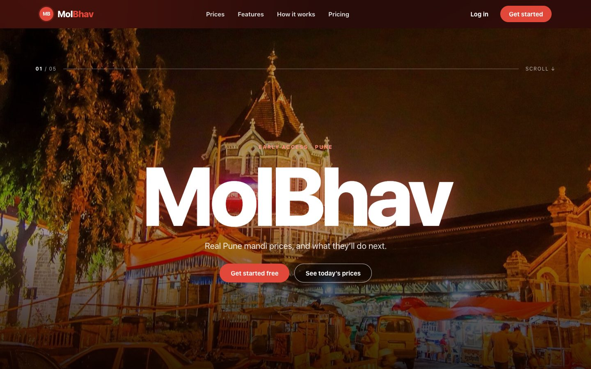
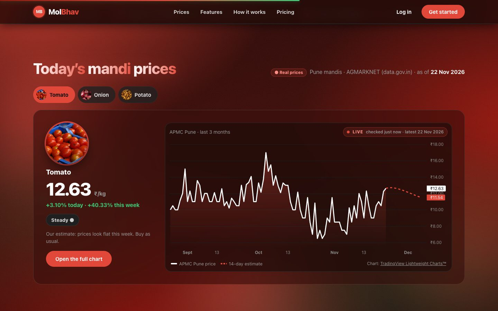
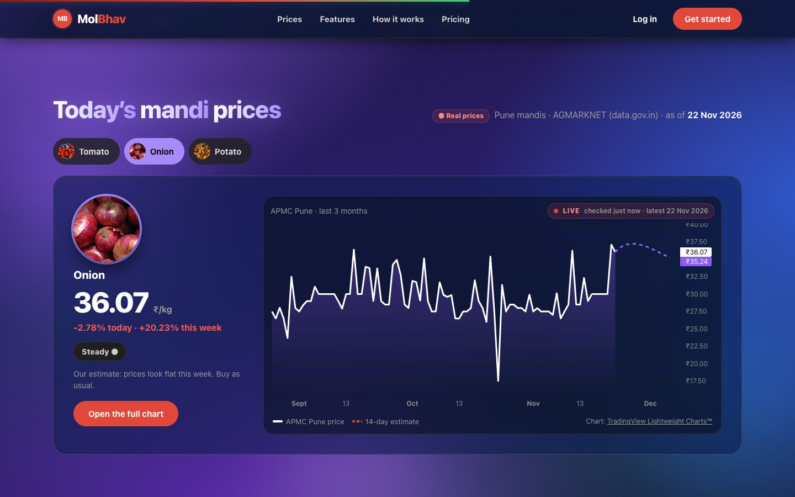
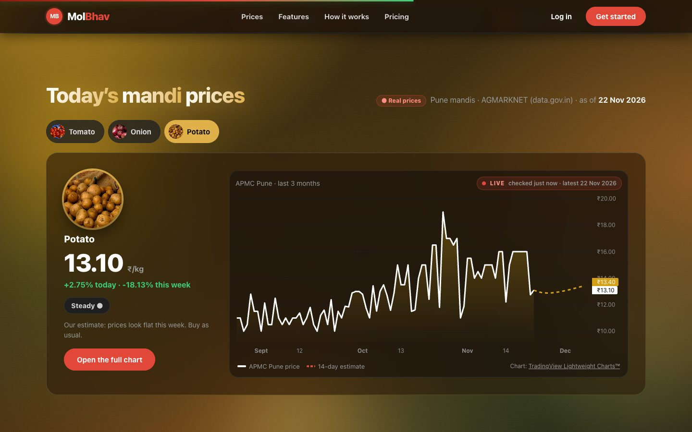
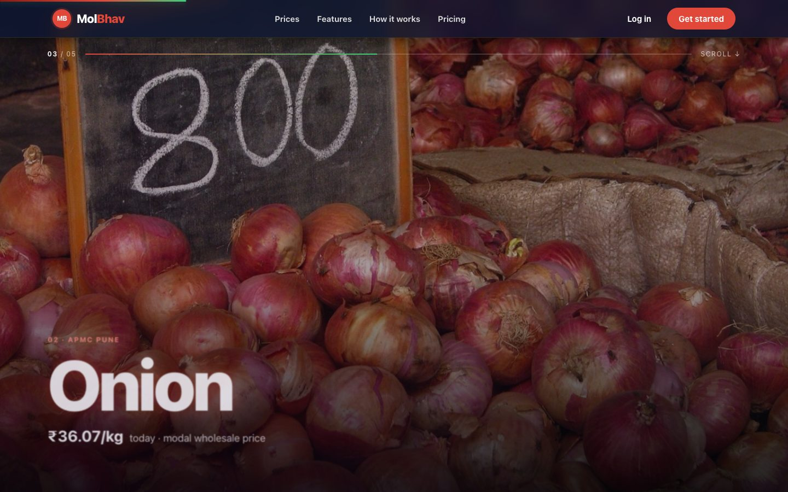
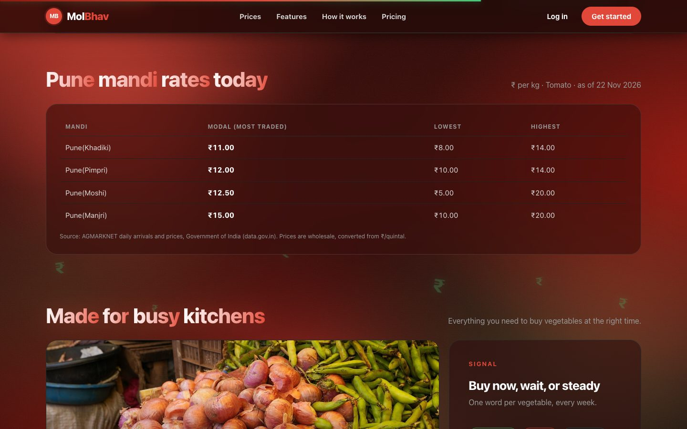
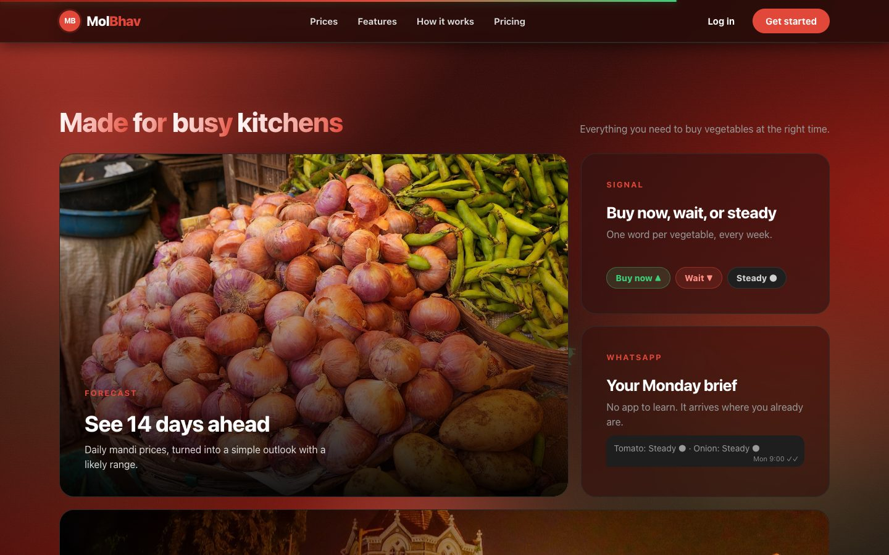
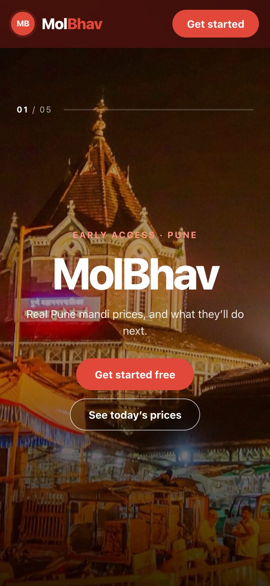
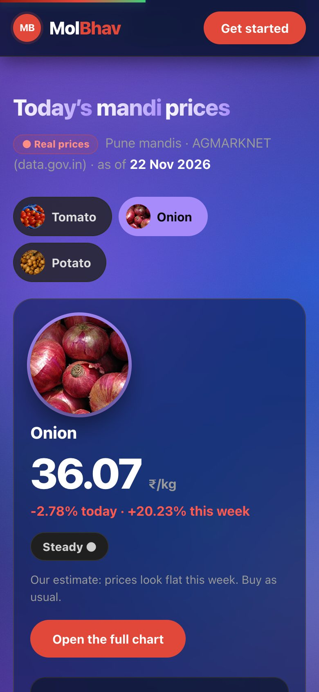

# MolBhav

**Real Pune mandi prices, and what they'll do next.**

MolBhav helps restaurants and cloud kitchens in Pune buy tomatoes, onions and potatoes at the right time.
It shows today's wholesale (mandi) prices from the Government of India's AGMARKNET data, a 3-month price
chart, a 14-day estimate, and a simple signal for each vegetable: **Buy now**, **Wait** or **Steady**.

**Live site:** https://molbhav-gamma.vercel.app



## Screenshots

### Today's mandi prices
Real APMC Pune prices with a live, growing chart (TradingView Lightweight Charts) and a 14-day estimate.
The whole page changes colour with the vegetable you pick: red for tomato, violet and blue for onion,
gold and brown for potato.



| Onion | Potato |
|---|---|
|  |  |

### Scroll story
The first screen is a pinned, film-like scroll story. Full-screen market photos cross-fade and zoom as you
scroll, and each scene shows today's real price.



### Every Pune mandi, side by side



### Made for busy kitchens



### On a phone

<p>
  
  &nbsp;
  
</p>

## Features

- **Real prices:** daily AGMARKNET arrivals and prices from data.gov.in for Pune mandis (APMC Pune
  Gultekdi, Khadiki, Pimpri, Moshi, Manjri and more), converted from ₹/quintal to ₹/kg.
- **Charts and estimates:** 3 months of history, a 14-day statistical estimate with a likely range, and a
  plain buy / wait / steady signal. These are estimates and are labelled as such.
- **Live updates:** prices refresh in the background while the page is open.
- **Sign-up with Google or email:** after signing in, people add their business name and type
  (restaurant, cloud kitchen and so on) and get a personal dashboard.
- **Private admin panel** at a secret path: sign-up counts, a live login counter, search, CSV export,
  removing people and an audit log.
- **Look and motion:** dark theme, per-vegetable colour themes, a scroll story, word-by-word headings
  and hover effects, built with [Motion](https://motion.dev).

## How it's built

| Part | What it uses |
|---|---|
| Server | Node.js, Express 4 (`server.js`), one serverless function on Vercel (`api/index.js`) |
| Database | libSQL: a local file on your laptop, [Turso](https://turso.tech) in production (`db.js`) |
| Prices | AGMARKNET via the data.gov.in API (`prices.js`), stored per day, vegetable and mandi |
| Front end | Plain HTML, CSS and JavaScript (`public/`), no framework |
| Charts | [TradingView Lightweight Charts](https://www.tradingview.com/lightweight-charts/) v5 |
| Animation | [Motion](https://motion.dev) 12 (`public/motion-fx.js`) |
| Hosting | Vercel, Mumbai region (`bom1`), because data.gov.in only accepts connections from India |

## Run it on your laptop

Needs Node.js 22.

```bash
npm install
npm run setup-admin        # asks for your admin email + password and prints the settings to keep
cp .env.example .env       # paste the printed lines into .env
npm start                  # open http://localhost:3000
```

The admin panel is at `http://localhost:3000` + the `ADMIN_PATH` value from your `.env`.
Prices are fetched from data.gov.in the first time someone opens the site, so the first load can take a few seconds.

### Settings (`.env`)

| Variable | Needed? | What it is |
|---|---|---|
| `ADMIN_EMAIL`, `ADMIN_PASSWORD_HASH`, `ADMIN_PATH` | Yes | Printed by `npm run setup-admin` |
| `ADMIN_TOTP_SECRET` | Optional | 2-step codes for the admin login (any authenticator app) |
| `GOOGLE_CLIENT_ID` | Optional | Shows the "Continue with Google" button (public value, no client secret) |
| `DB_PATH` | Optional | Local database file, default `./data/molbhav.db` |
| `DATABASE_URL`, `DATABASE_AUTH_TOKEN` | Production | Turso database address and token |
| `DATA_GOV_API_KEY` | Optional | Your own data.gov.in key; otherwise the public, heavily throttled sample key is used |
| `NODE_ENV` | Production | Set to `production` for HTTPS-only cookies |

`.env` is git-ignored. Never commit it.

## Deploy to Vercel

1. Create a free database on Turso and note its URL (`libsql://…`) and an auth token.
2. Link this folder to a Vercel project: `npx vercel@latest link`.
3. Add the settings above as **Production** environment variables. `scripts/push-env-to-vercel.sh` copies
   the admin and Google settings from your `.env`; add `DATABASE_URL` and `DATABASE_AUTH_TOKEN` in the
   Vercel dashboard.
4. Deploy: `npx vercel@latest deploy --prod --yes`.

Use your own `DATABASE_URL`, not Vercel's Turso integration. The integration gives each deployment a new,
empty database branch, so sign-ups would disappear on every deploy.

For Google sign-in, add your site's address (for example `https://your-app.vercel.app`) under
**Authorised JavaScript origins** of your OAuth client in Google Cloud.

## Security

- **No secrets in the browser.** The site's HTML and JavaScript contain no keys, hashes or the admin path.
- **Passwords** are hashed with bcrypt (cost 12). Sessions are random 256-bit tokens in `HttpOnly`,
  `SameSite=Strict`, `Secure` cookies, and only a SHA-256 of each token is stored.
- **User and admin sessions are separate.** The admin cookie is only sent to the secret admin path.
- **Brute-force protection:** 5 admin sign-in attempts per 15 minutes per IP, 20 for users.
- **Forgery protection:** every change needs a same-origin JSON request with a custom header.
- **Strict headers:** Content-Security-Policy (`'self'` only, plus Google sign-in when enabled), no framing,
  HSTS in production. All SQL is parameterised and user text is rendered as plain text.

## Data source

Prices: AGMARKNET daily arrivals and prices, Government of India, via [data.gov.in](https://data.gov.in).
Prices are wholesale modal prices. Forecasts and signals are statistical estimates, not advice.
